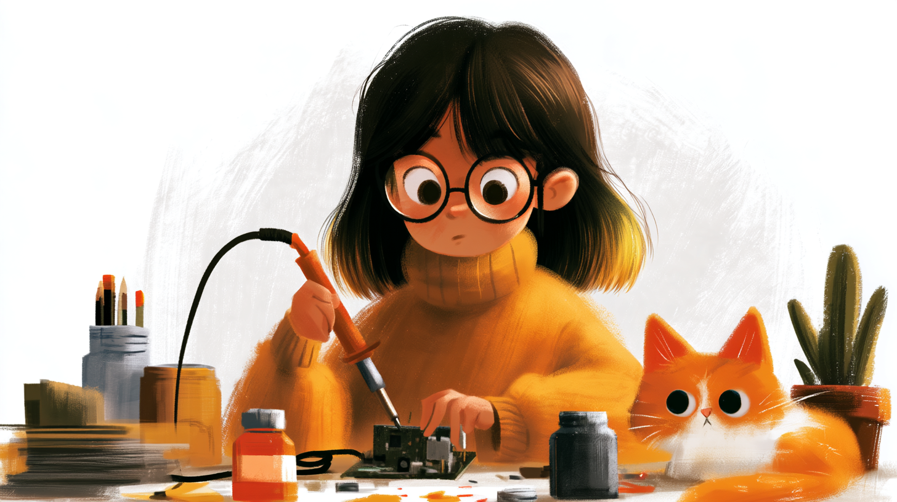

## 🎉 드디어 개발자가 되었어요!

그동안 목표로 삼았던 웹 프론트엔드 개발자는 아니고, **임베디드 엔지니어**가 되었습니다. _완전히 다른 길 아닌가?_ 싶으실 수도 있어요. 맞아요. 웹 프론트엔드는 완전한 하이레벨이고, 임베디드는 완전한 로우레벨이니까요. 

---

하지만 제가 정말 하고 싶었던 건 **정체되지 않고 계속 발전할 수 있는 일**이었어요.

지금까지 해 온 일들은 흔히 말하는 **비전**이 잘 그려지지 않았어요. 몸을 고되게 쓰는 데다, 일을 하면서 제가 발전한다는 느낌도 잘 들지 않았죠. 회사 선배들을 보면 직책이 올라가도 결국 비슷한 일을 계속할 것 같았어요. 물론 직책이 오르면 업무도 늘고 책임지는 범위도 넓어지겠죠. 하지만 제가 원한 건 맡는 일이 계속 바뀌고, 그 속에서 끊임없이 배울 수 있는 일이었어요.

사실 어렸을 때 꿈은 정보보안 전문가였어요. 그래서 일찍부터 리눅스를 만졌고, 중학생 때부터 네트워크 이론을 공부했어요. C++를 처음 접한 건 초등학생 때였고, 서버 개발자였던 외삼촌의 책을 탐독하며 이것저것 익혔죠. 어려서부터 개발자 체질이었나 봐요. 그런데 좀처럼 기회가 닿지 않았어요. **웹 프론트엔드**를 시작한 것도 부트캠프라는 쉬운 진입로가 있었고, 만든 결과물이 바로 눈에 보이는 데다 누가 내 서비스를 쓰는지 확인하기 쉽다는 점이 처음엔 매력적으로 다가왔기 때문이에요.

하지만 AI 붐이 본격적으로 일면서 웹 프론트엔드 직무로 취업하기는 더 어려워졌어요. 이력서를 돌리고 면접을 볼 때마다 AI보다 내가 나은 이유를 끊임없이 증명해야 했고, AI 티가 나지 않는 코드와 디자인을 계속 만들어 내야 했죠. 조금씩 지쳐 가기 시작했어요. 저는 저 자신과 경쟁하고 싶었는데, 난데없이 불청객이 끼어든 기분이었거든요.

그러던 중 놋찌가 걷고 있는 **임베디드 엔지니어**라는 길에 눈길이 가기 시작했어요. 놋찌가 하는 일을 어깨너머로 듣기도 하고, 토이 프로젝트를 돕기도 하고, 이것저것 알려 준 것도 많아서 대략 어떤 일을 하는지는 알고 있었거든요. 그러다 놋찌가 이직하는 과정에서 좋은 기회가 생겨 커피챗을 하게 됐고, 경력이 없는데도 무사히 개발자, 아니 엔지니어가 될 수 있었어요.

---

목표했던 웹 프론트엔드에는 결국 들어가지 못했지만, 낙심하지 않았어요. 오히려 굉장히 설레요. 내가 정말 엔지니어의 길을 걷게 되는구나 싶어서요. 문제를 찾으려고 멀티미터를 대 보고 스코프로 파형을 찍는 모습, 스키매틱을 보며 PCB를 설계하는 모습, 부품 선정 회의에서 의견을 나누는 모습을 상상하면 정말 멋지고 두근거려요. 이제 나도 그런 사람이 될 수 있구나, 열심히 해야겠다, 하는 생각들이 들어요.

1인분을 해내기까지는 시간이 오래 걸릴 수도 있어요. 관련 학과를 나온 것도 아니고, 경력도 없는 완전 초짜니까요. 그래도 저는 해낼 수 있다고 믿어요. 왜냐하면 **재밌거든요.** 무언가를 배우는 것도 재밌고, 그 과정에서 성장하는 저를 지켜보는 것도 재밌어요. 무엇보다 임베디드라는 분야 자체가 신기하고 재밌어요. 이렇게 재밌는 일을 하면서 돈까지 받을 수 있다는 게 제일 마음에 들어요.

놋찌는 이런 제 진취적인 모습이 멋지다고 해 줬어요. 실망시키지 않도록 열심히 할 거예요.
